# EvidenceDesk

> **I built EvidenceDesk as a trustworthy AI knowledge workspace for teams that need answers they can inspect, not merely generate.**

I built EvidenceDesk for teams that have policies, runbooks, technical documentation, operating procedures, or product references spread across files and need reliable answers from that shared knowledge. It is an authenticated organization knowledge workspace, not a one-file-at-a-time chat demo. Members reuse the same governed knowledge bases across conversations; each person’s research history stays private.

The core user journey is deliberate and traceable: create a workspace, create a knowledge base, upload a document, wait for a verified immutable revision to publish, ask a question, inspect the exact cited passage, compare published versions when needed, and explicitly approve any saved brief. When the selected knowledge cannot support the answer, the product explains that limitation instead of guessing.

## What I built

- Persistent shared knowledge bases with creator-private conversations.
- Immutable document revisions and fenced/idempotent parse, chunk, embed, and index jobs.
- Hybrid BGE-small dense retrieval, Qdrant sparse BM25, RRF, PostgreSQL rechecks, and bounded MiniLM reranking.
- Structured cited answers, source inspection, download of the cited original, and explicit abstention.
- LangGraph reference-only checkpoints for answers and a payload-bound approval workflow for private briefs.
- Local Qwen3 8B Q4 through Ollama plus policy/capability/cost/privacy-gated provider adapters.

## Live visual walkthrough

**[Watch the actual browser-recorded walkthrough](docs/12-portfolio/media/01-live-evidence-walkthrough.webm)**. Every image below was captured from the running local Compose application with a synthetic Harbor policy; they are not mockups. The [capture manifest](docs/12-portfolio/media/manifest.json) records the source integration evidence, image identities, and local-development TLS configuration.

### Figure 1 — Shared knowledge-base management

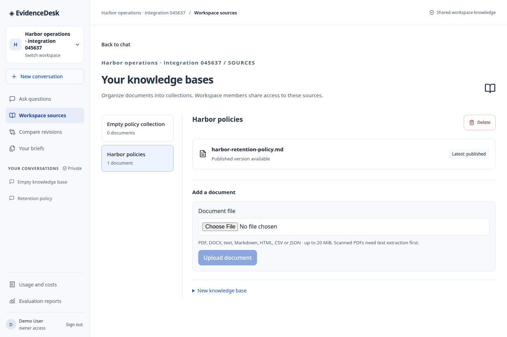

Members browse shared collections here. Editors can add a document, but an unfinished upload does not become searchable. The latest publication state is visible beside the document.

### Figure 2 — Immutable revision history

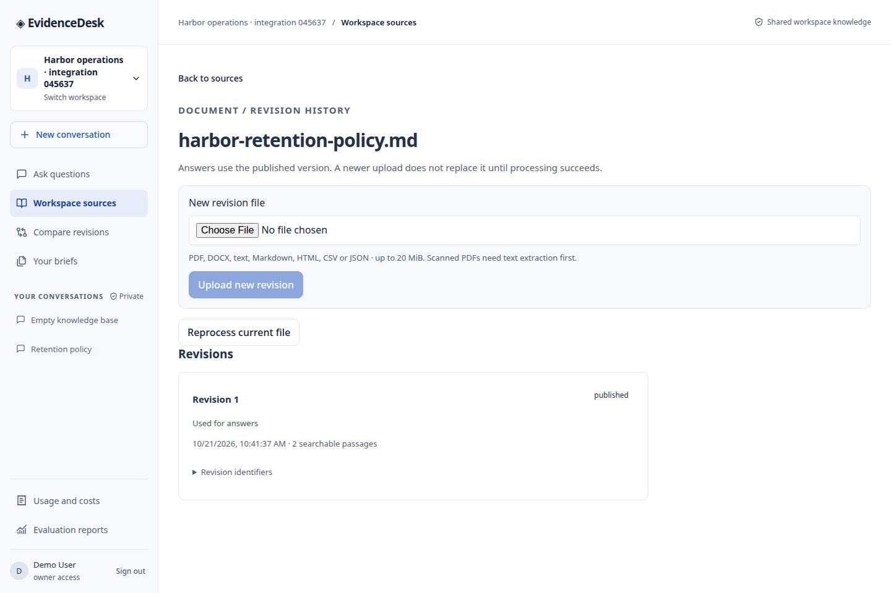

This timeline identifies the exact version used by answers, its processing state, searchable passage count, checksum, and stable revision identity.

### Figure 3 — Grounded answer and Figure 4 — citation inspection

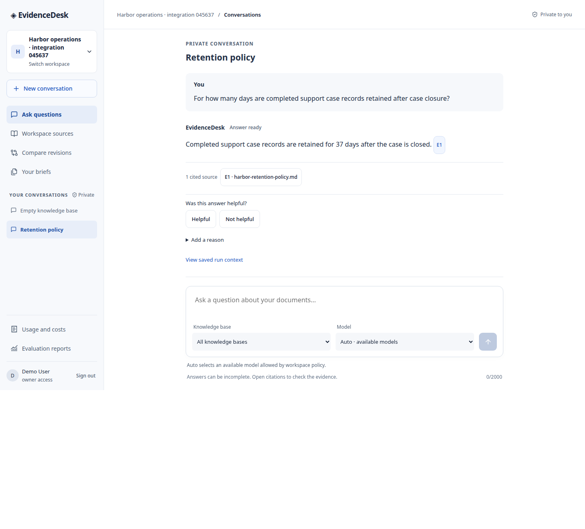

The private conversation makes the answer/evidence contract visible: the answer carries source `E1`, and feedback, saved-run context, and private-brief controls stay tied to that completed answer.

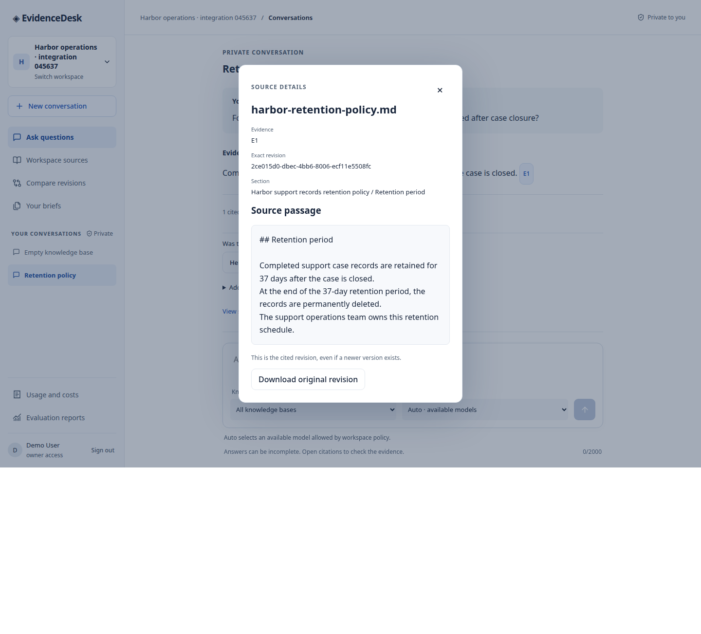

Opening `E1` fetches the authorized source chunk from the cited immutable revision. The dialog shows the exact passage that supports the 37-day claim, not just a document name.

### Figure 5 — Proposal approval and Figure 6 — saved private brief

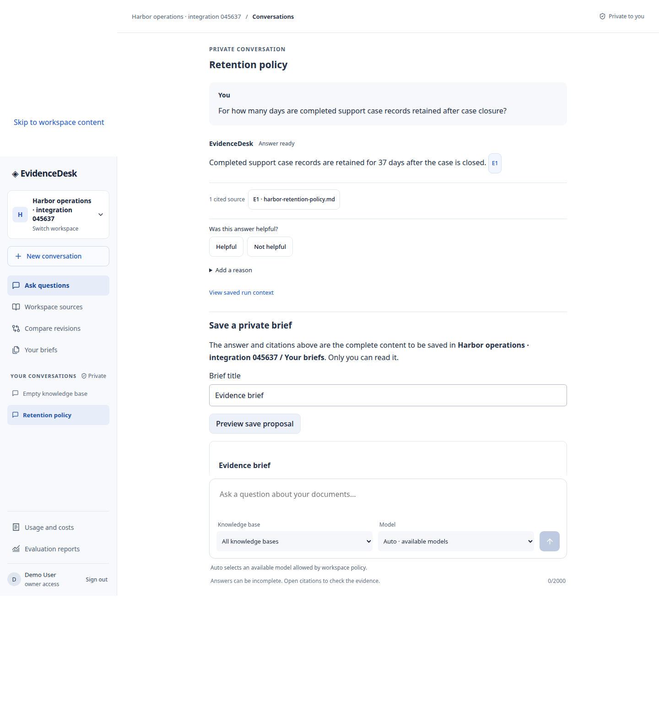

Saving is a two-step controlled write: a user previews a payload-bound proposal and then approves or rejects it.

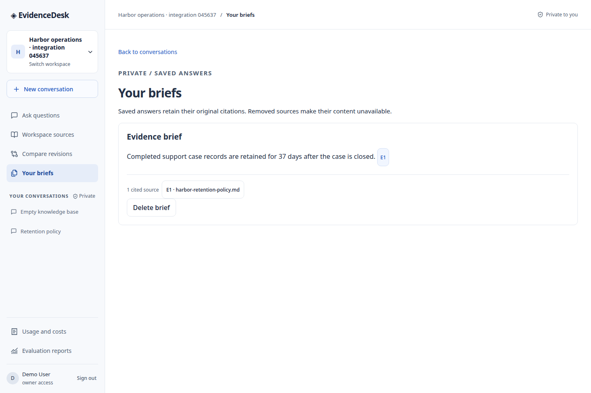

The approved brief remains creator-private and retains its evidence snapshot.

### Figure 7 — Responsive evidence-first chat

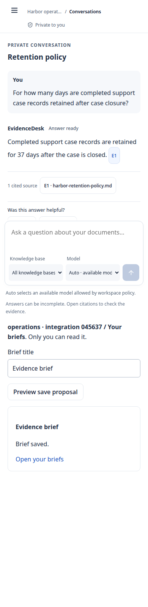

The narrow layout preserves the answer, citation, knowledge-base selector, model selector, and private-brief workflow.

### Figure 8 — Evidence-based abstention

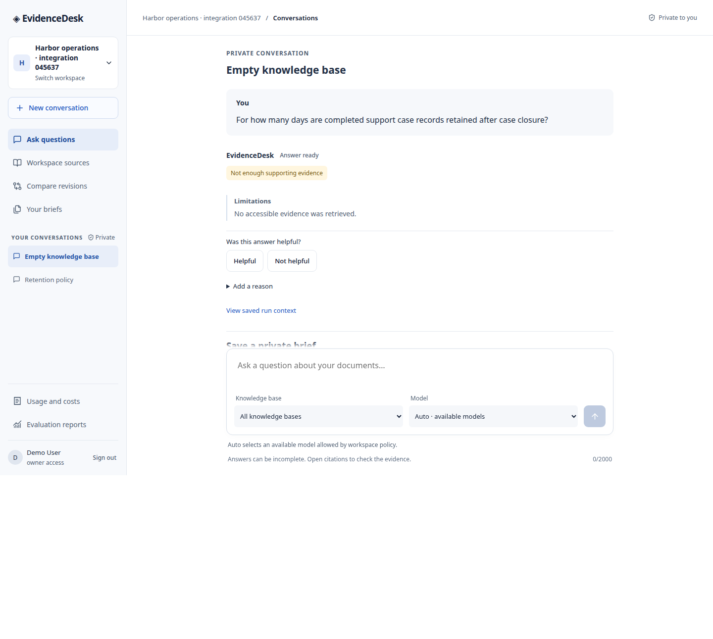

An empty knowledge base returns a first-class abstention state with a limitation, rather than a plausible invented response.

## Architecture

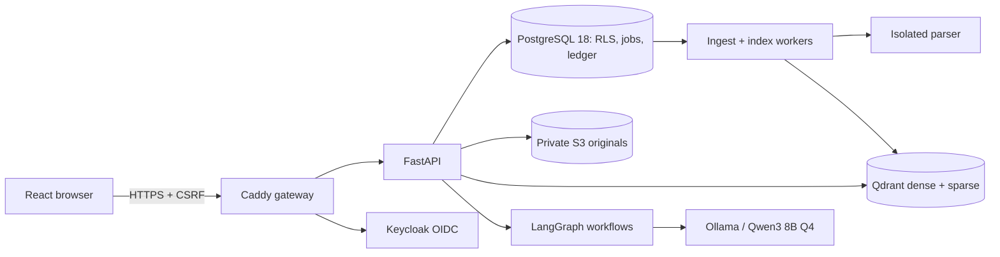

PostgreSQL is the authority for identity, tenancy, publication, jobs, billing, and permissions. Qdrant is derived: retrieval begins with a PostgreSQL-authorized revision allowlist, then candidates are rehydrated and rechecked before becoming evidence. The browser never receives object-store credentials.

### Ingestion and publication

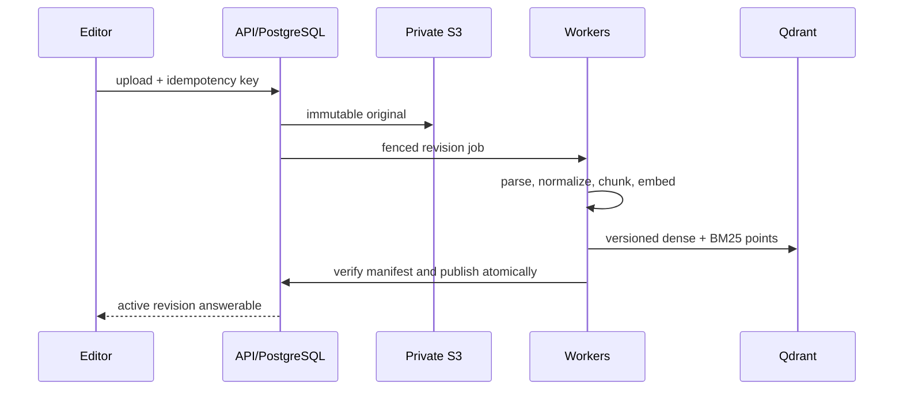

### Answer and evidence sequence

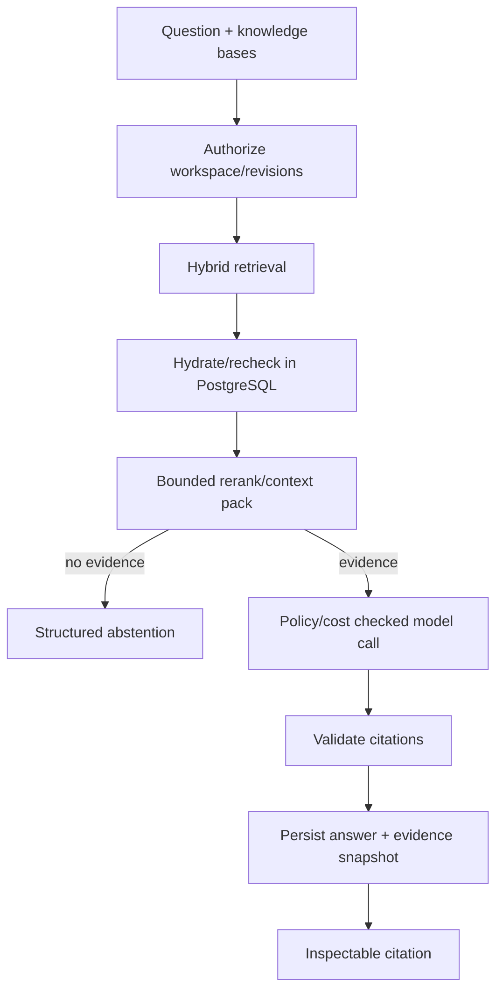

I keep untrusted documents and history inside explicit prompt boundaries, constrain context, validate citations against returned evidence, and avoid blind replay after partial streams. A citation names a chunk from an immutable revision, rather than just a document.

## Run the entire stack

```bash
git clone <your-fork-url> evidencedesk
cd evidencedesk
docker compose build
docker compose up -d
docker compose ps
docker compose exec -T model-health python -m infra.bootstrap.probe_loop --healthcheck
```

Open `https://evidencedesk.localhost:8443`. Trust the bootstrap local CA. The first start downloads/verifies locked local artifacts. The Compose topology includes gateway, frontend, API, PostgreSQL, Keycloak, private S3-compatible storage, parser, Qdrant, Ollama, model bootstrap, workers, and health checks. See [application operations](infra/application/README.md).

## Validation and limits

The [passed Compose RAG run](docs/10-testing/compose-rag-2026-10-21-attempt5.json) created a synthetic workspace, published a policy, generated a real local cited answer, inspected the source, exercised abstention, and logged out. This is functional end-to-end evidence, **not** a semantic-quality benchmark or public-production deployment claim.

Human-reviewed evaluation collection, broad restore/recovery evidence, and remediation/applicability review for unresolved container scan findings remain open. The relevant public records are [security findings](docs/06-security/findings.md), [evaluation documentation](docs/07-evaluation/evaluation-plan.md), and [operations documentation](docs/08-observability/operations.md). For full design detail, start with the [documentation index](docs/index.md), [master architecture](docs/02-architecture/master-architecture.md), [retrieval design](docs/03-ai-engineering/retrieval.md), [LangGraph workflows](docs/03-ai-engineering/langgraph-workflows.md), and [ADRs](docs/adr/README.md).

## Product tour: how every user-facing workflow works

### 1. Create a workspace and build shared knowledge

I model the product around a workspace because an organization should upload a policy once and use it across many conversations. Workspace membership determines who may discover and manage shared knowledge; the role determines whether that member can create knowledge bases, upload documents, change settings, or only ask questions. I keep private conversation ownership separate from workspace roles so an administrator cannot casually browse a colleague’s research history.

An editor creates a knowledge base, uploads a supported document, and sees the revision lifecycle rather than a misleading instantaneous “uploaded” state. The UI shows a draft/new revision separately from the current published revision. That avoids a common RAG failure mode where a partially processed or failed upload silently changes the knowledge used by answers.

### 2. Publish a document revision safely

Each file upload creates an immutable original in private object storage, a document revision, and an idempotent job. The worker extracts structured text through the isolated parser, normalizes it, chunks it with heading-aware context, creates frozen-tokenizer embeddings and BM25 artifacts, writes a staged Qdrant representation, and verifies the expected point manifest. Only then does a PostgreSQL transaction mark the revision published.

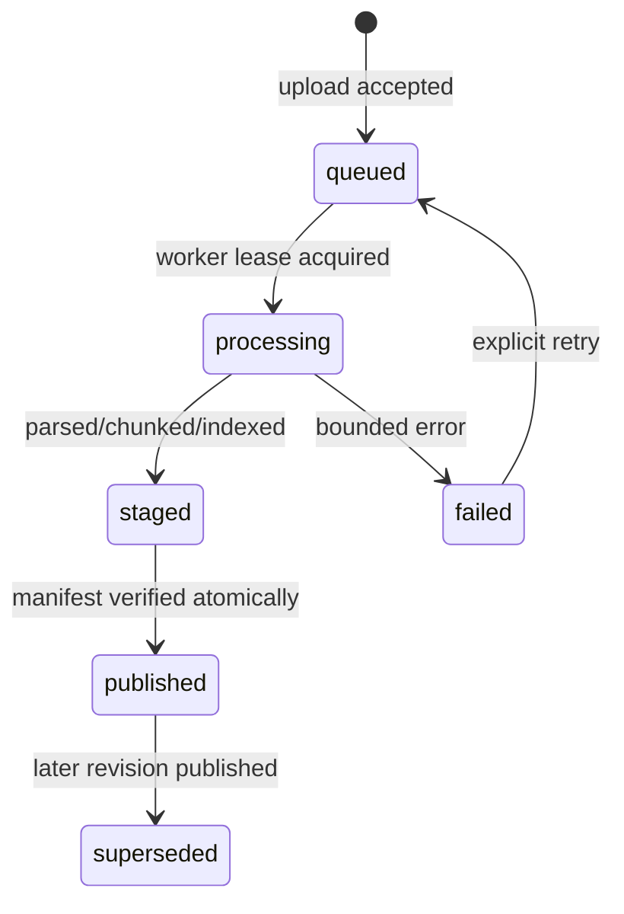

The revision visible in [the live history screen](docs/12-portfolio/media/03-revision-history.png) is the source of truth for retrieval. Historical revisions remain available for comparison and citation integrity under the documented retention rules.

### 3. Ask a grounded question

The chat composer lets the user constrain a question to one or more knowledge bases and choose an available model that workspace policy permits. Before generation, the server obtains an authenticated workspace context, creates a durable run with an idempotency key, reserves budget, and starts the bounded answer graph. The browser receives durable server-sent events for status and provisional progress; the final saved answer is only promoted after the output and citations pass validation.

The answer is not a bare string. It is a structured result containing a status, sentence list, evidence IDs for each supported sentence, limitations, and a citation snapshot. A final answer with unsupported, malformed, or unavailable evidence is rejected rather than rendered as authoritative.

### 4. Inspect the evidence

Every citation opens an evidence dialog. The dialog fetches the authorized chunk using the citation’s document and revision IDs, displays the exact text, section path, page metadata when available, and lets the member download that precise original revision. This protects against a subtle but consequential product mistake: displaying a newer document version as if it supported an older answer.

The [citation inspection capture](docs/12-portfolio/media/05-citation-inspection.png) demonstrates this end-to-end: the answer says “37 days,” and the opened source passage contains the exact 37-day rule.

### 5. Compare revisions without blending evidence

The comparison screen requires exactly two distinct published revisions and a stated comparison focus. Each side retains its own revision allowlist and citations. The resulting conversation saves comparison metadata so that a reopened run can show its A/B provenance only while the user remains authorized and both sources remain live. If a source is redacted, its display metadata is cleared rather than retained as stale evidence.

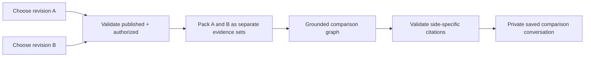

### 6. Save a private brief through approval

I intentionally did not expose an open-ended agent write tool. From a completed answer, a user can make a brief proposal whose payload includes the answer message, citations, title, digest, expiry, and current authorization context. The user then explicitly approves or rejects that exact proposal. A worker writes the brief only after the approval is valid. [The proposal capture](docs/12-portfolio/media/06-brief-approval.png) and [saved result](docs/12-portfolio/media/07-private-brief.png) show the two steps.

### 7. Give an honest answer when evidence is absent

No relevant accessible chunk produces a structured abstention, a visible “Not enough supporting evidence” state, and a limitation explaining that no accessible evidence was retrieved. This behavior is shown in [the live abstention screen](docs/12-portfolio/media/09-evidence-abstention.png). It is deliberate product behavior, not an error page.

## Data model and ownership boundaries

The relational schema has clear ownership chains. `workspaces`, `memberships`, `knowledge_bases`, `documents`, `document_revisions`, `chunks`, and index manifests describe organization-shared knowledge. `conversations`, `messages`, `runs`, tool executions, and briefs track the creator-private interaction plane. Jobs, audit events, usage ledger records, evaluation records, deletion tombstones, and workflow threads provide operational state.

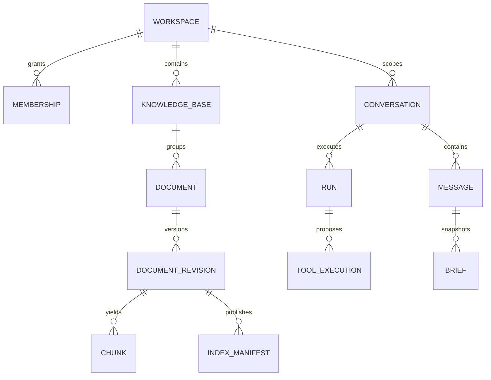

At request time, the API scopes the PostgreSQL transaction with the authenticated actor and workspace. Row-level security enforces that scope in the database instead of relying only on route code. The runtime role is neither a table owner nor `BYPASSRLS`. Qdrant IDs, storage keys, and LangGraph checkpoints are references to authoritative records; none of those systems makes a permission decision on its own.

## Retrieval and model pipeline in detail

| Stage | Implementation choice | Reason |
| --- | --- | --- |
| Chunking | Frozen tokenizer, bounded chunks, heading/table context | Keeps source spans attributable and context bounded. |
| Dense retrieval | CPU BGE-small embedding profile | Reproducible local semantic recall. |
| Sparse retrieval | Qdrant BM25 artifacts | Preserves lexical matches such as policy numbers and names. |
| Fusion | Reciprocal-rank fusion | Combines complementary retrieval signals without score-scale assumptions. |
| Authorization | Revision allowlist plus PostgreSQL hydration/recheck | Makes the derived index incapable of granting access. |
| Reranking | Bounded CPU MiniLM process | Improves ordering while enforcing batch, token, and timeout limits. |
| Prompt packing | Whole passages, evidence cap, quoted untrusted content | Avoids truncating evidence into unattributable fragments. |
| Generation | Native local/hosted provider adapters | Applies policy, capability, budget, and privacy checks consistently. |
| Validation | Sentence/evidence contract plus source availability | Blocks unsupported or stale citations from becoming final answers. |

The local Compose model is a locked Ollama Qwen3 8B Q4 artifact. It is selected for a practical local demonstration, not presented as a blanket quality claim. Embedding, reranking, generation templates, tokenizers, and model metadata are versioned or locked so a later run has identifiable inputs.

## How EvidenceDesk turns documents into trustworthy answers

The application is more than “RAG plus a model.” I designed each AI module with an explicit input, output, safety boundary, operational limit, and evaluation question. The detailed specifications remain in [`docs/03-ai-engineering`](docs/03-ai-engineering), while this section explains how the pieces work together in the deployed product.

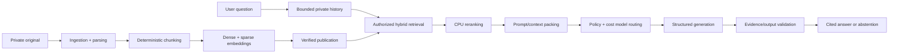

### Document ingestion and parser isolation

The ingestion module accepts bounded PDF, DOCX, Markdown, text, HTML, CSV, and JSON inputs. It validates actual MIME/magic rather than trusting the filename, rejects encrypted/legacy/archive/executable inputs, limits file size, pages, extracted bytes, blocks, and chunks, and records parser warnings. Parsing occurs in an isolated, networkless service with resource limits. It emits structured blocks and provenance rather than an untraceable text blob.

The resulting revision moves through validating, parsing, normalization, chunking, embedding, verification, and publication. Every stage is durable and idempotent. A lease token fences stale workers; object checksums, manifests, and document locks prevent a late or partial worker from publishing a bad revision. [The ingestion specification](docs/03-ai-engineering/document-ingestion.md) defines formats, limits, state transitions, recovery, and fixtures.

### Chunking and provenance

`structure_v1` is heading-aware rather than a blind fixed-character splitter. It packs adjacent semantic blocks toward 320 tokens, with a hard 384-token cap counted by the pinned BGE tokenizer. It preserves page/block/character provenance, heading paths, normalized text spans, and a deterministic UUIDv5 identity. Tables retain header context; code boundaries preserve language and line boundaries; short evidence is not discarded just to meet a preferred minimum.

This design matters because retrieval text and cited text have different jobs. The embedding copy can contain bounded heading context for discoverability, but citations always point to original normalized source text and offsets. The [chunking design](docs/03-ai-engineering/chunking.md) lists deterministic and no-text-loss properties tested for each profile.

### Embeddings and hybrid index

Each published chunk receives a CPU-friendly BGE-small dense embedding and a sparse BM25 representation. The embedding profile, tokenizer, model revision, vector dimensions, source hash, and artifact hashes are recorded. Qdrant stores the derived vectors and minimal payload metadata; PostgreSQL remains authoritative for visible source text and permissions.

Index publication is a separate verification step: staged vectors must match expected IDs, counts, dimensions, hashes, and source coverage before PostgreSQL flips the document’s active revision pointer. If Qdrant is stale, missing, or inconsistent, the system reports that as an unavailable retrieval state rather than silently treating it as no evidence. See [embeddings](docs/03-ai-engineering/embeddings.md) and [Qdrant publication](docs/05-database-and-storage/qdrant-index.md).

### Authorized retrieval and fusion

The retrieval service first resolves the user’s currently authorized knowledge-base and revision allowlist in PostgreSQL. Every dense and sparse Qdrant branch carries workspace, knowledge-base, revision, and profile filters. Returned points are then hydrated from PostgreSQL under row-level security and rejected if the document has been deleted, superseded out of ask scope, or otherwise become unavailable.

Dense BGE and sparse BM25 results are combined with deterministic reciprocal-rank fusion (`RRF-60`). The service never widens source filters merely to fill a result count. Empty evidence is distinct from a Qdrant outage; one failed branch can return a marked degraded retrieval result, while both failing becomes an explicit retrieval error. This is why the product can abstain honestly instead of converting infrastructure failure into “no information.” Details: [retrieval algorithm](docs/03-ai-engineering/retrieval.md).

### Reranking and context packing

The reranker only sees already-authorized passages. A bounded, separate CPU process scores up to 20 RRF candidates with the pinned MiniLM cross-encoder, batched in eights with tokenizer-aware pair truncation, a hard deadline, and a deterministic RRF fallback on timeout or invalid output. Raw logits remain internal; the UI does not present a ranking score as user-facing confidence.

The context packer chooses at most eight whole passages within a 3,072-evidence-token budget. It removes near-duplicates, preserves a feasible passage from both sides in comparisons, leaves source text intact, and trims old chat history before dropping evidence. It counts the complete provider request—including instructions, schema, history, evidence, and output reserve—using the matching locked tokenizer. Read [reranking](docs/03-ai-engineering/reranking.md) and [grounded generation](docs/03-ai-engineering/rag-generation.md).

### Prompt engineering and output integrity

Prompts are versioned resources, fingerprinted at render time. System/developer rules, user question, quoted history, and quoted untrusted evidence are separately delimited. Evidence IDs are assigned server-side; source documents cannot introduce their own authority, change knowledge-base scope, or choose tools. This separation mitigates prompt injection structurally, while the system still treats retrieved content as untrusted.

Generation must return a strict structured answer. The validator checks JSON shape, text bounds, UTF-8, evidence-label membership, duplicate citations, citation provenance, and quoted excerpts when present. It never treats a cited label as proof of semantic entailment; quality evaluation remains the check for that. A malformed, partial, unsupported, or source-revoked answer cannot become final. [Prompt policy](docs/03-ai-engineering/prompt-engineering.md) and [answer contract](docs/03-ai-engineering/rag-generation.md) explain the exact rules.

### Conversation memory, rewrite, and summary experiments

Core memory is intentionally conservative: only the creator’s current conversation can contribute, at most six completed user/assistant pairs fit under a 2,048-token history cap, and only if their recorded evidence remains visible. Failed messages, hidden tool arguments, and unbounded cross-chat preferences do not become context.

Pronoun-aware query rewrite and compact conversation summaries are implemented as fenced experiments, not promoted serving behavior. They share the run’s privacy, token, and cost budgets; preserve literal quantities and polarity; cannot widen knowledge scope; and fall back to the original query/history on ambiguity or failure. Their promotion requires paired evaluation rather than attractive examples. See [conversational memory](docs/03-ai-engineering/conversational-memory.md).

### Model abstraction, routing, and accounting

Provider adapters expose a common typed contract for model capabilities, structured output, streaming, token counting, errors, and accounting. The local Ollama route and optional hosted routes are selected only after policy, privacy, availability, context capability, and budget checks. A cost reservation occurs before a provider call, and usage records preserve known/estimated/unknown accounting states so retries cannot hide spend.

The model router does not silently switch a private-only workspace to an external provider. It also does not retry an uncertain issued generation call: an ambiguous transport outcome ends in an interrupted state because blindly retrying could create a duplicate or divergent answer. See [model abstraction](docs/03-ai-engineering/model-abstraction.md) and [routing](docs/03-ai-engineering/model-routing.md).

### LangGraph workflows and bounded tools

LangGraph coordinates durable answer and approval workflows, but it is never the authorization source. Checkpoints store references, IDs, hashes, graph step, and budgets—not raw private prompts or documents. Each node reloads current database state and rechecks authorization, source visibility, cancellation, and policy. A complete provider response can be replayed for validation; an uncertain provider attempt cannot be reissued.

The project deliberately avoids unrestricted agents. Ordinary question answering uses the fixed retrieval-to-answer graph. Comparison accepts exactly two authorized revisions. The only state-changing tool is a private brief save proposal, restricted by typed schemas, current role, argument hash, expiry, payload hash, and explicit user approval. There is no browser, shell, arbitrary HTTP, SQL, or email tool. Read [LangGraph workflow design](docs/03-ai-engineering/langgraph-workflows.md) and [bounded tool contracts](docs/03-ai-engineering/agents-and-tools.md).

## Security, privacy, and reliability controls

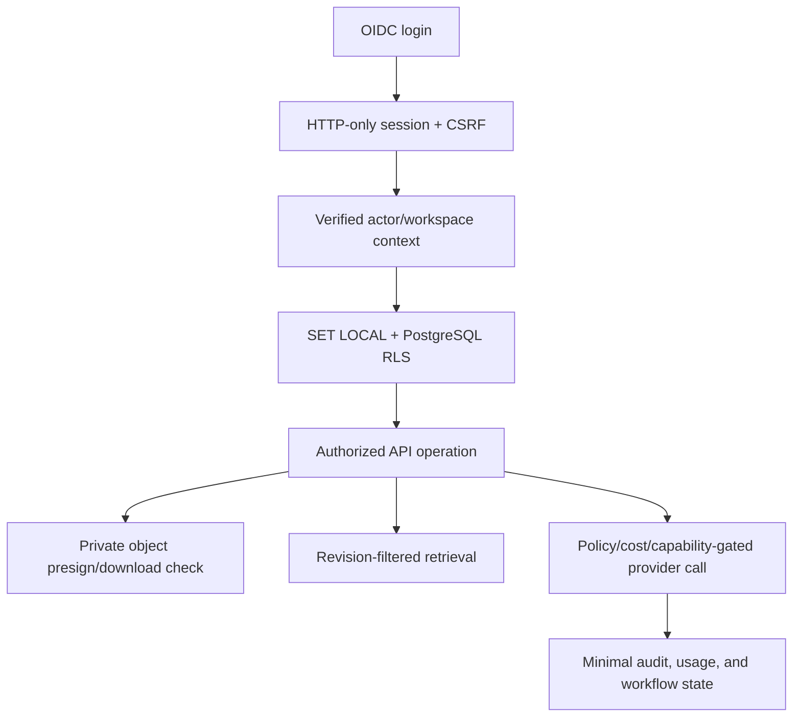

- **Identity and browser boundary:** Keycloak OIDC, server-managed sessions, CSRF protection, strict HTTPS ingress, and no browser-held provider or storage credentials.
- **Tenant and privacy boundary:** composite workspace ownership relationships, scoped database transactions, RLS, and creator-private conversations even inside a shared workspace.
- **Ingestion boundary:** parser isolation, supported-format allowlist, bounded file sizes, immutable object storage, checksum tracking, idempotency keys, and lease fencing.
- **Generation boundary:** no provider call before cost reservation; output schema/citation validation; no blind replay after partial provider output; explicit terminal states.
- **Tool boundary:** brief writes use a bounded, payload-hashed proposal plus user approval. The model does not choose arbitrary endpoints, SQL, code execution, or unrestricted tools.
- **Derived-state boundary:** Qdrant is filtered, hydrated, verified, and reconcilable; deletion and redaction take precedence over stale index/cache state.

The security implementation and unresolved release findings are documented in [the threat model](docs/06-security/threat-model.md), [reliability controls](docs/06-security/reliability.md), and [findings](docs/06-security/findings.md).

## Deployment topology and operations

`compose.yaml` is intentionally a full local product topology, not a frontend-only demo. It starts bootstrap, PostgreSQL, database initialization, Keycloak, SeaweedFS S3, storage initialization, Qdrant, Ollama, locked-model initialization, parser, Caddy/web UI, API, ingestion/index/chat/brief/purge workers, and model health checks. Only the HTTPS gateway is exposed on loopback; data services stay on internal networks.

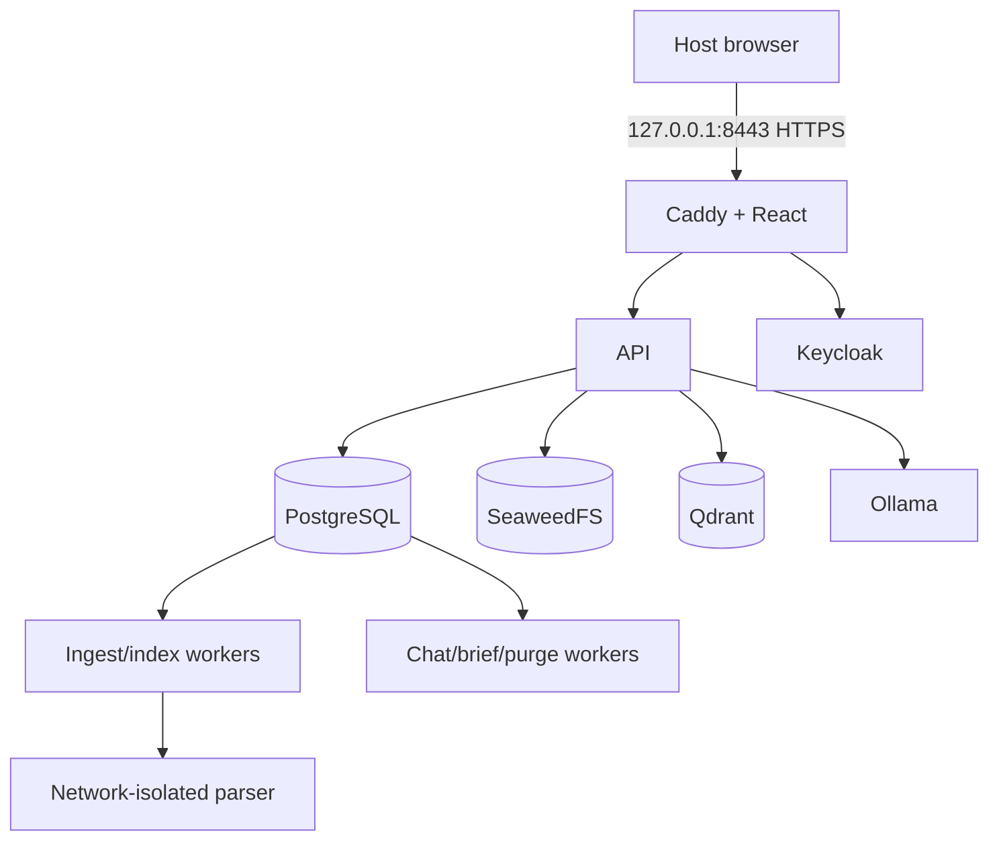

Every image is pinned and Compose applies read-only filesystems, non-root users where compatible, dropped capabilities, `no-new-privileges`, resource limits, tmpfs scratch locations, health checks, and local log rotation. Exact service behavior, bootstrap, troubleshooting, and model preparation procedures live in [local Compose documentation](docs/09-infrastructure/local-compose.md), [deployment design](docs/09-infrastructure/deployment.md), and [application image documentation](infra/application/README.md).

### Useful local commands

```bash
# Start or inspect the local system
docker compose up -d
docker compose ps
docker compose logs -f api chat ingest index

# Check model readiness and stop the stack
docker compose exec -T model-health python -m infra.bootstrap.probe_loop --healthcheck
docker compose down

# Run source checks and focused real-browser validation
make check
make test
.tools/node-v24.21.0-linux-x64/bin/node scripts/validate_compose_browser.mjs \
  --project evidencedesk --output docs/10-testing/local-browser-run.json --scope published
```

## Evaluation, observability, and recovery posture

I treat evaluation as a separate engineering surface, not a single “looks good” demo. The project contains evaluation cases, reviewed-label workflows, retrieval variants, answer/citation scoring, selective-answering analysis, context-sensitivity diagnostics, feedback capture, and usage/cost views. The system records task provenance so an evaluation can be tied to corpus, configuration, model, and scoring rules.

Operationally, I use structured logs, OpenTelemetry boundaries, Prometheus-oriented metrics/rules, provider health state, durable job progress, leases, audit events, and a cost ledger. Durable job retries are at-least-once and fenced; writes are designed to be idempotent. Deletion/tombstone workflows and conversation-purge workers exist to make lifecycle behavior testable rather than treating retention as a UI-only promise.

I have not converted incomplete evidence into a production claim: human-reviewed quality evaluation, full restoration drills, and review/remediation of the remaining high/critical scanner occurrences are still release blockers. The public technical records explain the current controls, evidence, and boundaries without presenting incomplete work as a release claim.

## Documentation map

| Area | Starting point |
| --- | --- |
| Product and requirements | [PRD](docs/01-product/prd.md), [NFRs](docs/01-product/nonfunctional-requirements.md) |
| System design | [master architecture](docs/02-architecture/master-architecture.md), [interfaces](docs/02-architecture/interfaces.md) |
| Retrieval and generation | [retrieval](docs/03-ai-engineering/retrieval.md), [RAG generation](docs/03-ai-engineering/rag-generation.md), [model routing](docs/03-ai-engineering/model-routing.md) |
| Database and storage | [schema](docs/05-database-and-storage/schema.sql), [Qdrant design](docs/05-database-and-storage/qdrant-index.md) |
| Security and operations | [threat model](docs/06-security/threat-model.md), [operations](docs/08-observability/operations.md) |
| Verification | [test catalog](docs/10-testing/test-catalog.md), [integrated Compose evidence](docs/10-testing/compose-rag-2026-10-21-attempt5.json) |
| Decisions | [ADR index](docs/adr/README.md) |

## Scope and honest limitations

EvidenceDesk is an authenticated organization knowledge workspace. It is not a public chatbot widget, autonomous web crawler, automatic Drive/Notion connector, unrestricted agent, or publicly hosted SaaS deployment. Local demonstration evidence proves the integrated paths described above; it does not prove domain-general answer quality, high availability, or security readiness for an internet-facing deployment. Those boundaries are intentional, visible in the design, and tracked as concrete work rather than hidden behind marketing language.
