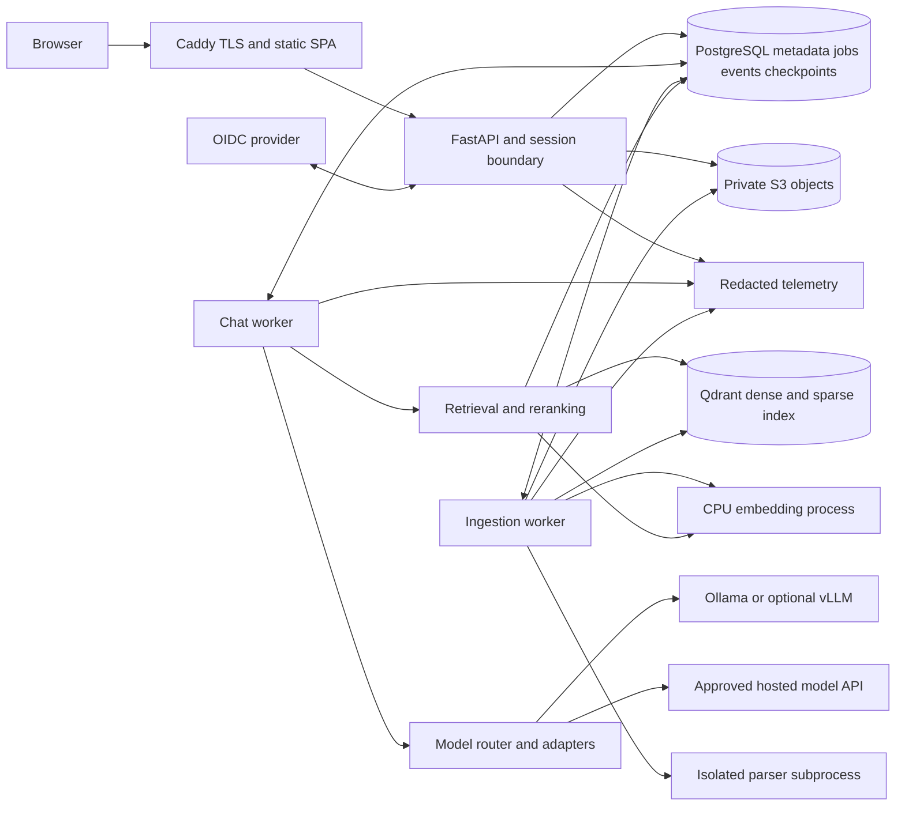
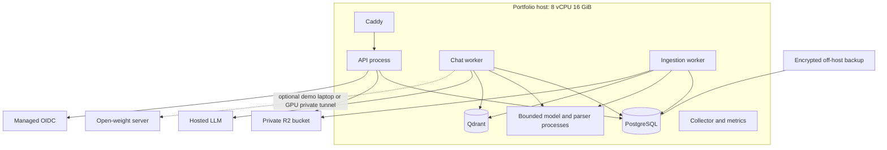
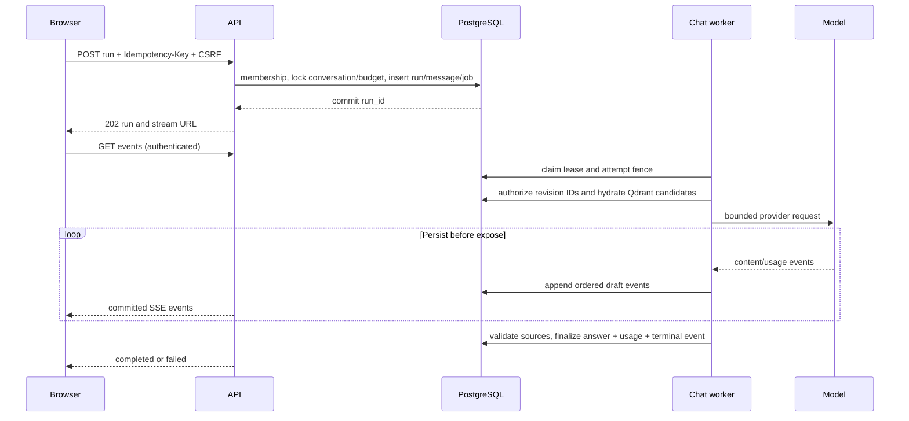
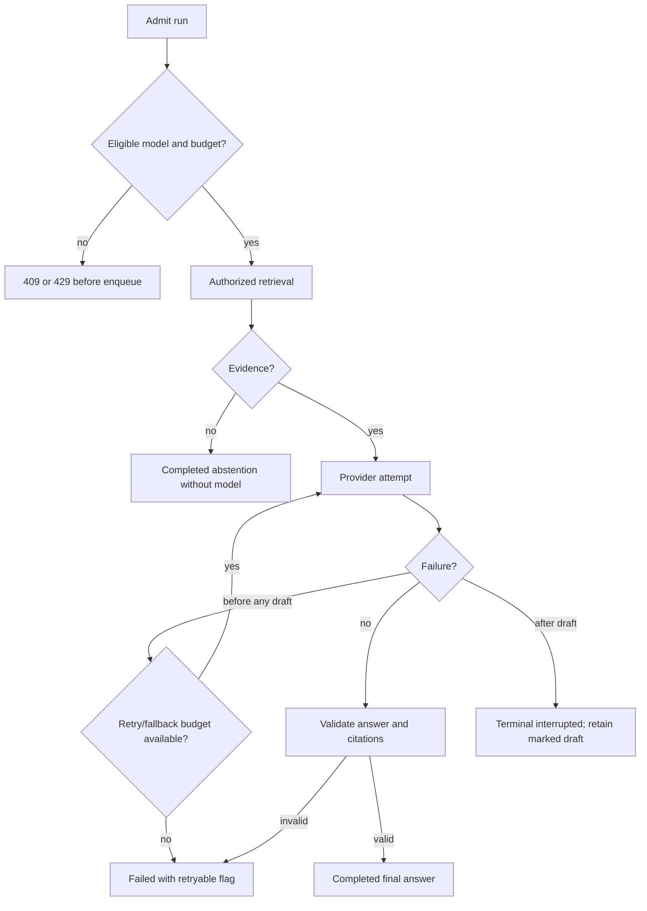

# EvidenceDesk — authoritative architecture

## Status and scope

Specification v2, 2026-10-10. Production-oriented capstone, not a claim of production readiness. [PRD](../01-product/prd.md), [SQL](../05-database-and-storage/schema.sql), [OpenAPI](../../contracts/openapi.yaml), and [backlog](../../tasks/implementation-backlog.md) are normative. If these disagree, stop the affected task, resolve the conflict in a documented change, and update all consumers; do not silently choose whichever is convenient.

**Core:** modular Python backend, React SPA, PostgreSQL18 + Qdrant1.19 + LangGraph1.2, S3-compatible private objects, PostgreSQL durable jobs, local BGE embeddings and MiniLM reranker. OpenAI and Ollama are required adapters; Anthropic/Gemini have concrete contracts and later tasks. Qdrant and LangGraph are core; no mandatory Redis, Kafka, Kubernetes or always-on GPU. The [current stack](../00-research/current-stack.md) records researched version targets.

## System invariants

1. Every workspace-owned record has `workspace_id`; child references include it. User content is never retrieved without live membership and tenant scope.
2. Documents are visible to all workspace members. Conversations, messages, runs, evidence bundles and briefs are creator-private. Workspace admin is not permission to read another person's chat.
3. Only one complete revision is active per document. Publication swaps a PostgreSQL pointer only after Qdrant points are acknowledged and verified; authorized revision filters exclude staging. An index outage fails closed rather than pretending a distributed atomic transaction exists.
4. Database state is authoritative. Object storage contains immutable blobs; job notifications and process caches are dispensable hints.
5. A run has one terminal state and one ordered durable event log. Reconnection replays existing events; it does not invoke a model again.
6. Every provider attempt is budget-reserved, measured and settled or explicitly estimated. An outage never relaxes privacy, capability, or budget constraints.
7. Retrieved text, tools and memory are untrusted data. Authorization and approval live in application code, not model instructions.
8. Source and membership revocation are rechecked before prompt egress, event replay and final commit. Already-disclosed data cannot be recalled; document this residual limit.
9. Soft deletion fences access immediately. Purge is retryable; backup restore applies deletion tombstones before serving traffic.
10. All quality/latency/resource numbers are hypotheses until benchmarked against the declared workload.

## Components and boundaries

| Component | Responsibilities / interface | Dependencies | Failure behavior / scaling |
|---|---|---|---|
| React SPA | Upload, chat, evidence, reports; generated OpenAPI client, authenticated fetch SSE | Reverse proxy/API | Reconnect by event ID; responsive source drawer; static replicas |
| Caddy ingress | TLS, static assets, same-origin `/v1`, streaming pass-through, body limits | API | 503 with request ID; no stream buffering; single-host then managed LB |
| Identity/session service | OIDC PKCE callback, opaque sessions, CSRF, membership context | IdP, PostgreSQL | Fail closed; short login transaction; stateless API replicas |
| API/domain services | Validation, role/object checks, transactions, jobs/run admission | PostgreSQL, private objects | 4xx domain errors, bounded 5xx; do not run CPU inference in event loop |
| Chat worker | Lease run, build context, route, retrieve, generate, verify, persist events | Providers, retrieval, DB | Fenced lease; orphan mid-stream becomes interrupted, never blind continuation |
| Ingestion worker | Immutable revision pipeline | Object store, parser subprocess, embedding process, DB | Stage checkpoint, bounded retries, atomic publish; scale independently |
| Parser subprocess | Extract only local prevalidated bytes | Preinstalled parsers, read-only input descriptor in dedicated offline service | No network; per-request UID/seccomp/CPU/RAM/time caps; bounded manifest or error. Compose uses the Unix-socket isolation design; host tests retain per-document containers. |
| Retrieval service | Tenant-scoped Qdrant dense+sparse BM25, RRF, optional cross-encoder, evidence packing | Qdrant, authoritative DB, local model process | Sparse-only degradation if embedding fails; abstain if both fail/empty |
| Provider adapters/router | Capabilities, token accounting, bounded attempts, health | Allowlisted model endpoints | Explicit-selection no model switch; auto bounded fallback before first draft |
| Tools/workflow | LangGraph ask/compare and separate brief approval graph | Same authorized repositories | Three calls max, no arbitrary network/SQL/shell; recover persisted checkpoint |
| Lifecycle worker | Purge, lease sweep, retention, aggregates | DB/object store | Idempotent batch jobs, alert on stale tombstones |
| Evaluation runner | Frozen experiments and offline report import | Same application interfaces, public fixtures | Not in serving hot path; independently capped spend |
| Telemetry | Structured redacted logs, OTLP spans, Prometheus metrics | Collector/backend | Drop sampled traces under pressure; never block usage accounting |

Module interfaces are defined in [interfaces](interfaces.md). SQL transactions end before network/model calls. Long streams never hold DB connections; append deltas in small transactions (≤100 ms or 256 text bytes, whichever first), then release. At most 5 generation slots total, 2/workspace. Workers use separate chat/ingest queues so large PDFs do not block accepted chats.

## High-level and deployment views

Single-host demonstration has a single point of failure; availability target is not an HA guarantee. Local developer profile may run Keycloak and S3 emulator on a24 GiB laptop; public demo uses managed OIDC/object storage. Scaling reference: ≥2 API instances and workers, managed multi-zone PostgreSQL, object storage, centralized telemetry, separate inference nodes. PgBouncer transaction pooling requires SET LOCAL context per transaction. Kubernetes is a future scheduling option, not a prerequisite.

## Request and failure flow

## Durability and concurrency decisions

Job leases last 30s and heartbeat every 10s; parser may run up to 60s under renewing parent lease. Every stage write requires `(job_id, lease_token, lease_until > now())`; expired worker cannot publish. Database monotonic `lease_token` increments on each claim. Ingestion attempts up to 3 with jittered 2/8/30s delay; no retries for malformed files. Chat pre-output transient provider retries at most one, one fallback candidate, at most 3 attempts total and always within 60s. Chat worker crash after any draft makes run interrupted via sweeper. A new user retry starts a new run and distinct cost reservation.

Cancel API writes `cancel_requested`; worker checks before each stage/provider chunk, aborts network request, and terminalizes cancelled. Provider may bill already-produced output; finalize unknown usage conservatively. SSE reader disconnection alone does not cancel a durable run. Stream duration capped 65s/server connection; reconnect allowed within 24h event retention. Reauthorization every 5s and before emitting a batch.

## Architecture review boundary

This package is ready for design review after its documented contract checks. It does not authorize pretending that live compatibility, quality gates, backup drills or load tests passed. User requested specification before application code; implementation starts only after architecture review. See [audit](../11-implementation-plan/final-audit.md) for what was and was not validated.

## v2 durability boundaries

PostgreSQL owns business truth, durable jobs, public events, index manifests/outbox and thread ownership. Qdrant holds rebuildable dense/sparse points; LangGraph owns graph execution checkpoints in a dedicated PostgreSQL schema through its supported saver migrations. These stores have no shared commit. [Index protocol](../05-database-and-storage/qdrant-index.md) defines stage→upsert→verify→pointer swap, tombstone-first purge, reconciliation and restore. [Workflow protocol](../03-ai-engineering/langgraph-workflows.md) defines graph state, serialization, leases, checkpoint replay, provider ambiguity and approval interruption. No process/model framework bypasses the existing AuthContext, budget or event interfaces.

The full portfolio target includes both bounded compare and durable approval recovery. With the additional state boundaries, plan14–18 focused weeks. The hosted demo sizing hypothesis becomes16 GiB, with Qdrant separately capped and no local8B generator. Product scope stays a document knowledge workspace; extra autonomous agents and external side-effect tools remain out of scope.
