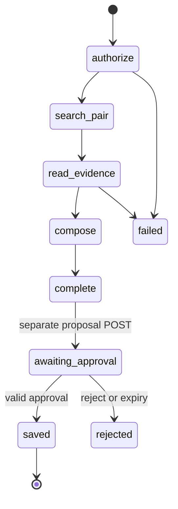

# Bounded workflows and tool contracts

The capstone demonstrates controlled tool execution, not open-ended autonomy. Ordinary QA has no agent loop. Comparison accepts exactly two authorized revision IDs and a focus question; bounded LangGraph workflow searches both, reads selected passages, generates a sourced comparison, and optionally proposes an internal brief. Native LLM tool calling is not required for this workflow, so local models remain first-class.

Graph progress lives in PostgreSQL-backed LangGraph checkpoints; authoritative effects live in tool_executions. Logical state includes: run/workspace/actor, selected revisions, intent, evidence IDs, step, remaining calls/time/cost, executed argument hashes, pending payload hash, config versions. Maximum 3 read-tool calls per run, 1 generation, 60s active run time, no self-recursion. Approval is a separate post-answer operation expiring after 10min; it does not keep worker lease or SSE open. Duplicate `(tool_name, canonical_args_hash)` in same run returns prior authorized result; repetition of same failing call terminates workflow. Recovery resumes safe read steps only before a provider attempt is issued. An uncertain issued attempt becomes interrupted even without visible draft; persisted complete responses may resume validation.

## Registry and execution contracts

| Tool | Typed input/output | Permission, deadline and side effect |
|---|---|---|
| `search_knowledge` | `{query: string <=2000 chars, kb_ids: UUID[1..10], limit:1..8}` → evidence IDs/text/provenance + degraded flags | Member, read; scope intersected with server run scope; 3s; one retry only if transient and budget remains |
| `read_passages` | `{chunk_ids:UUID[1..8]}` → exact chunks with revision/page and digest | Member and run actor, read; no URL/path; 2s; missing/revoked any item fails closed |
| `compare_revisions` | `{left_revision_id,right_revision_id,focus<=2000}` → paired evidence selection and comparison Answer | Member; deterministic composition of bounded retrieval; 60s run deadline; both revisions same workspace, can be superseded but not deleted |
| `save_brief` | `{title<=120,answer_message_id}` → `{brief_id,created_at}` | Editor or higher AND own final message; internal DB write; 2s; explicit approval bound to generated content hash and current role |

Input schemas are in [tool schemas](../../contracts/schemas/tools.schema.json); all successful outputs must validate against [tool-result schema](../../contracts/schemas/tool-result.schema.json) before entering context. Failed tools return typed ToolError internally, never a successful payload containing an error string. Tool IDs, actor/workspace and authorized scope are injected by executor, never model fields. Registry entries define input/output schema IDs, permission predicate, effect class, timeout and retry policy. A tool result carries execution ID, name/version, source IDs, retrieved_at and SHA256 payload. Limit total tool result text to 32 KiB and context budget; tool text stays untrusted.

Approval POST requires execution_id, decision, expected_payload_sha256. Proposal freezes title, message/answer hash, actor, workspace, expiry and policy version. Approval transaction locks execution, validates current membership/editor role/source availability, records decision and enqueues graph resume. The separate save node rechecks these predicates, inserts brief with unique execution_id and transitions succeeded atomically. Double submit returns existing ToolExecution and, after successful save, the same brief; approval with changed hash 409; expired 409; revoked user 404. UI shows complete proposed brief and destination before click. There is no email, external ticket, browser, shell, arbitrary HTTP or SQL tool.

Testing: model-supplied workspace spoof, unauthorized chunk, approved payload modified, concurrent approvals, source deletion while awaiting approval, replay after logout, simulated save failure before/after commit, loop exhaustion, malicious output asking to reveal secrets. Audit stores action IDs/hashes/status and no raw confidential payload. Acceptance requires zero unauthorized effects in the adversarial suite and exactly one artifact under retry.

## Selected runtime

[LangGraph workflow protocol](langgraph-workflows.md) is normative for graph nodes, state, migration, locks and restart. Approval can return approved/running while the durable worker finishes; UI polls ToolExecution and displays saved only when succeeded+brief_id. No graph progress events append to a completed answer stream. Framework interrupt state alone is never approval.
