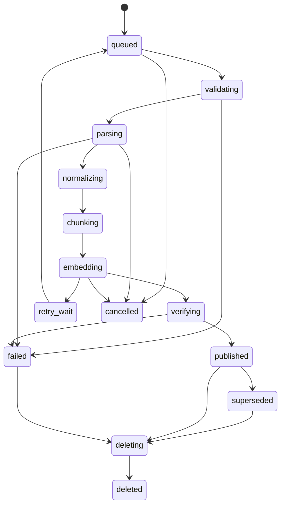

# Document ingestion and publication

## Supported input contract

One multipart file ≤20 MiB, uncompressed extracted bytes ≤100 MiB, ≤200 pages, ≤10k blocks, ≤5000 chunks/document revision. Core: text PDFs via pypdf, DOCX via python-docx, Markdown/plain UTF-8, HTML via lxml/BeautifulSoup with scripts/styles removed, CSV via bounded csv reader, JSON via standard parser depth ≤20 and ≤50k scalar entries. Reject encrypted PDF, legacy .doc, archives, executable content and unsupported encodings with stable errors. Office zip inspection rejects absolute/parent paths, >1000 members, >100 MiB total uncompressed bytes or >100:1 expansion. Validate actual MIME/magic; filenames are display metadata only.

DOCX/HTML page numbers are null; never invent pagination. PDFs keep page index starting at 1, headings when extraction supports them; record parser warnings and extraction limitations. Tables flatten row-by-row with headers repeated and source row ranges. Wide rows exceeding chunk cap split by cell with row/column locators. Embedded images are recorded as omitted with counts; no vision/OCR claim in core. PDF with <20 extracted non-whitespace chars/page on >50% pages fails `ocr_required`; mixed PDFs record skipped pages and require explicit editor acceptance before publishing partial coverage. Core default rejects partial coverage. Stretch Docling OCR uses separate resource profile, language packs and human spot-checking; [Docling capabilities](https://docling-project.github.io/docling/) are not evidence of file fidelity.

## State machine

Public revision status uses the stage names above. Jobs have separate queued/running/retry_wait/succeeded/dead/cancelled status; job checkpoint.stage identifies the current revision stage. Cancellation/deletion is legal from every nondeleted stage. Retries resume an idempotent stage, not partially written buffers. Failed reprocess leaves old active revision available. `superseded` source revisions remain citation-readable until document deletion.

## Step contracts

| Stage | Input → durable output | Invariant / error handling |
|---|---|---|
| Receive | stream → private original object + document/revision/job transaction | Content length/hash verified while streaming; object written before DB commit; orphan sweeper after 24h |
| Validate | original bytes → validation manifest | Recheck size/MIME/archive limits in worker; SHA mismatch permanent failure |
| Parse | local temp file → blocks JSON object + parse manifest | Network disabled, 60s wall/1 GiB RAM/1 CPU, no unsafe deserialize; temp wiped on exit |
| Normalize | blocks → canonical Unicode NFC blocks | Preserve original text mapping; strip NUL/unsafe controls, whitespace normalization; hash versioned |
| Chunk | canonical blocks → chunk rows staged under revision | Deterministic ordinals/UUIDv5, token/provenance validation; no visible pointer yet |
| Embed | chunk embedding_text → vector rows | Batch 32 CPU initial, normalized dimensions/finite checks; upsert only identical hashes/profile |
| Verify | manifests + rows → verified manifest | Count equality, no gaps/duplicate ordinals, all vectors, source coverage and profile consistent |
| Publish | verified revision → active document pointer + completed job | Lock document; lease fence/live tombstone/config check; swap active revision in one transaction |

Object key `workspaces/{workspace_id}/documents/{doc_id}/revisions/{revision_id}/{kind}/{sha256}`; kind original/blocks/manifest. Opaque IDs and hash are server-generated. Store original content-type but always download attachment. Object credentials allow only private bucket. Original is immutable; revision manifest pins parser, chunker, embedding revisions and checksums.

## Concurrency, duplicates and recovery

POST new document requires Idempotency-Key; identical key/body replays result for 24h, changed body 409. Content dedupe is within document, workspace and profile; identical content in another KB is a distinct document for lifecycle clarity. Reprocess locks document, rejects another active reprocess 409, creates monotonically increasing revision_no. Exact same checksum/profile already published returns existing revision/job reference. Do not infer duplicates from filename.

Lease token increments on claim; all checkpoint and publication updates match current token and unexpired lease. Retry transient storage/model error up to 3 attempts; deterministic parse errors dead immediately. Retries reuse verified artifacts by checksum, delete invalid intermediate artifacts, and never create new source revision IDs. Dead jobs require explicit editor retry/reprocess with new job generation. Deletion sets tombstone before cancellation, so late worker cannot republish. Sweep abandoned original blobs and failed intermediates after 24h; object deletion may lag without restoring read access.

## Acceptance fixtures

Text PDF with known page labels; duplicate DOCX; malformed zip; macro-bearing office upload; script HTML; UTF-8 combining characters; empty/scan-only/mixed PDF; wide CSV and deep JSON; source revision race; worker death after each durable stage; expiry while old worker tries publish; DB commit failure after object upload; object loss on retry. For 10 golden documents compare exact text/provenance expected outputs rather than file-count-only assertions.

## v2 index delivery stage

After embedding, write immutable dense+sparse vector artifacts and PostgreSQL index manifest/outbox in the specified order. The outbox delivers Qdrant points, verifies exact IDs/counts/hashes and only then permits active revision publication. Existing external revision status `embedding` covers artifact generation; `verifying` covers delivery/verification; no new HTTP status is needed. Staging points never enter an authorized revision allowlist. Read the normative [Qdrant protocol](../05-database-and-storage/qdrant-index.md) for competing uploads, lost acknowledgement, purge races and reconciliation; atomic publication refers to the PostgreSQL pointer, not a distributed transaction.
