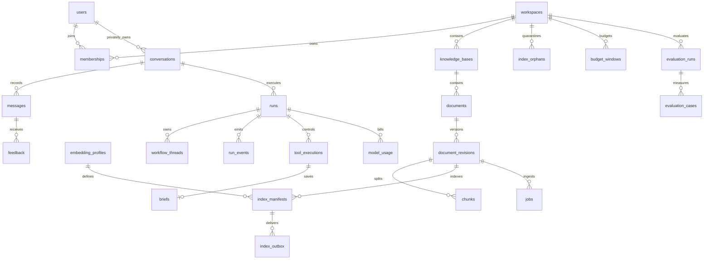
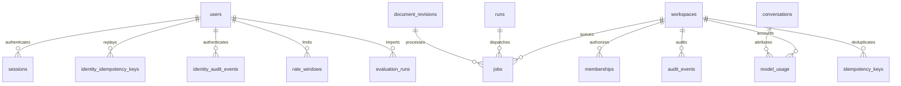

# Database, objects and lifecycle

[Reference SQL](schema.sql) defines 34 business tables with composite tenant relationships, indexes and RLS. Runtime SQL must be tested against actual PostgreSQL18 before release; syntax validation alone does not prove authorization or query plans. UUIDs are generated server-side. UTC timestamps and integer micro-USD avoid ambiguous time zones/floating money. SQLAlchemy models map these names without a second conflicting schema; Alembic migration tests compare metadata with contract DDL.

## Access roles and RLS limitations

Migration role owns schema; API/worker runtime roles have no superuser, BYPASSRLS, ownership or DDL permissions. Generic RLS is a **tenant fence**, not complete user/role authorization. Domain services must verify current membership, role, object creator and tombstones before setting scope and every sensitive use. SQL injection that permits arbitrary session settings defeats this fence; only bound SQL and reviewed repositories are allowed.

Bootstrap identity and workspace discovery require a separate identity DB role with SELECT users/sessions/memberships/workspaces and narrowly scoped membership lookup methods. Do not give this credential to retrieval/provider modules. Preferred implementation is SECURITY DEFINER functions for `list_user_workspaces(user_id)`, `get_membership(user_id,workspace_id)` and atomic `create_workspace(user_id,name)` with fixed search_path, revoked PUBLIC EXECUTE and runtime grant only; function owner can read these tables across RLS, code returns only specified membership. T03/T04 implement and adversarially test these functions. Authenticated user ID comes from validated session, not a request parameter. This avoids circular membership RLS discovery. Identity functions perform no document reads.

Workers need a narrowly privileged `claim_job(kind,worker_id)` routine to choose across tenants; returns only job identifiers and authorized actor/scope, no raw content. SECURITY DEFINER claim routine locks one eligible row and increments token atomically. Regular stage work uses scoped worker role. Maintenance traverses workspace IDs using operator role and emits per-workspace audit; no such endpoint is exposed to users. These privileged routine bodies belong to T05; their exact behavioral contract is in backend design.

## Transaction boundaries

- Create workspace: insert workspace and owner membership, initialized budgets and default profiles in one transaction. Last-owner mutations lock workspace and count owners inside same lock.
- Upload: write private object and hash first; lock quota/document and insert revision+job+idempotency response. Orphan sweeper cleans object if transaction fails. Concurrent quota admission uses sum of live original sizes under workspace lock.
- Publication: lock document; check tombstone, current lease, revision verified count/profile; old active status superseded, new published, pointer/latest/version and corpus_generation increment, job success in one commit.
- Run admission: lock workspace admission/budget then conversation in that order everywhere; validate version/active slot; increment sequence; insert user message, run, first event, job, reservation and idempotency response. Provider request happens after commit.
- Final answer: verify live scope/source; lock run, validate worker fence; insert final assistant message, citations, usage settlement, terminal event and terminal state atomically.
- Brief approval: lock execution; check hash/expiry/creator/role/source; record decision and recovery job atomically. Separate LangGraph save node rechecks authority then inserts unique brief and updates execution/audit atomically.

Deadlock prevention uses workspace→conversation/document→run/job→execution lock order. On serialization/deadlock error retry entire short transaction ≤2 with jitter; never repeat external model call as part of transaction retry. Unique constraints are final defenses, not substitute for readable business conflicts.

## Deletion semantics

Soft deletion acknowledges only after new read/replay authorization observes the tombstone. In-flight already-authorized/network-buffered batches follow the bounded revocation contract in streaming.md; zero instantaneous network retraction is not promised. DB content purge removes dependent records after invalidating active requests; `model_usage` is converted to content-free aggregate accounting and its run/conversation pointers nulled **before** deleting those objects (reference DDL allows null). Preserve user ID only for stated usage retention; account erasure pseudonymizes it via a separate operator procedure. Original document deletion invalidates any message/brief citations and summaries referencing its IDs: redact evidence quotes/drafts and mark affected final answers `source_unavailable` on read; purge content-bearing answers if they reproduce deleted source text. The lifecycle job identifies dependencies from runs.evidence/messages.citations/briefs.citations JSON IDs and scans affected workspace; add relational citation table if measured scan cost warrants it.

Implemented source-derived redaction (ADR019): `source-redact` drains one terminal run per transaction, selected through deleted direct evidence or marked parents in frozen history IDs. It permanently marks the run unavailable, fences pending effects, clears generated answer/citation/summary/provider content and drains events/tool/brief content in100-row pages. Parent markers propagate within the same private conversation; independent answers are preserved. An unfinished-page marker supports retries. User-authored queries and content-free accounting remain. Active runs must terminalize before a later sweep; source rows must remain until this dependency redaction is drained. Original/source object and vector physical purge remains separate pending work.

Implemented source object namespace cleanup (ADR021): `source-objects-purge` records a standalone `document_objects` tombstone before storage deletion, removes at most100 keys below the deleted document UUID prefix and receipts only a verified empty listing. Original/reprocessed/staging/derived keys share this boundary. Receipt sweeps repeat after1h and survive workspace cascade. Enabled/suspended bucket versioning is refused. This component does not remove PostgreSQL chunks/titles/index anchors or complete parent purge jobs; those steps remain pending.

Conversation deletion cascades runs/events/tools/briefs/messages/feedback after usage detachment. Documents may have active/latest revision circular FKs: set both pointers null before deleting revisions/document. Purge workspace in ordered batches, then physical workspace row; tombstones survive independently. Job performing workspace purge cannot rely on its own row surviving final cascade; mark external deletion manifest purged first. Tombstone log is backed up separately and retained 35d (30d backup + 5d margin), contains IDs/object keys only, no user content.

Implemented conversation slice (T28/ADR018): `conversation-purge-worker` selects conversation jobs only, rechecks their tombstone/creator/fence and processes one run per page. It fences active jobs before conservative usage settlement, clears provider response content, and stores standalone `workflow_thread` tombstones before saver deletion. These thread IDs survive application cascades and are included in later checkpoint reconciliation. Every mapped thread needs a successful deletion receipt before its application mapping disappears. Child rows/cached responses are drained in100-row pages and checkpoint work in25-thread pages; the final conversation delete, parent purge receipt and job completion commit together. Shared documents, original objects and Qdrant points are unaffected. Independent off-host deletion logs and full restore replay remain pending.

Implemented conversation expiry (ADR020): `conversation-expire` atomically tombstones up to25 conversations at least90 days old and queues the same creator-bound purge jobs as manual deletion, including after membership departure. Expiry fences new access and requests active-run cancellation; the purge worker performs physical erasure. Fleet scheduling remains pending.

Data retention: events/idempotency 24h; conversations and summaries 90d from conversation creation (new messages do not extend this fixed lifetime); failed staging artifacts 24h; deleted live objects ≤24h; aggregate usage/audit 90d; evaluation metadata indefinite on public fixtures; encrypted backups 30d. A read proxy rechecks authorization immediately before bytes, but cannot revoke already delivered bytes. No public object ACLs/presigned downloads.

T28 implementation checkpoint: `replay-prune` removes expired workspace idempotency rows and events for terminal runs beyond the existing24-hour run-created-at replay boundary. It clears provider-response bodies older than24h only after accounting settles and no run job/reservation needs recovery; aggregate usage and saved history remain. Each transaction caps each category at100 rows, skips locked rows and rolls back on failure. `checkpoint-prune` separately deletes expired terminal checkpoints and retains reconciliation receipts. These operator commands need periodic scheduling; physical source/object/workspace purge, identity/audit/90-day usage retention and backup deletion-log replay are still unfinished. ADR017 records the retention boundaries and ADR018 the implemented conversation purge.

## Indexing and migrations

PostgreSQL has B-tree scoped lookups, outbox indexes and unique business constraints. Qdrant owns dense/sparse indexes; exact filtered queries benchmark ANN under skewed tenants. Partial indexes enforce one active run and one terminal event. New model dimensions require a new Qdrant collection and verified manifests, not casting old embeddings. Expand schema → deploy compatible readers/writers → backfill → validate → switch → later contract; destructive migration cannot accompany app rollback. Take encrypted backup and test restore before irreversible schema change.

Object manifests are authoritative for checksums, not permissions. Reconciliation daily compares DB refs and object existence, detects missing blobs, retries purge and reports orphan age. An object missing for a published document marks source unhealthy; retrieval must not invent original provenance. A DB backup plus independently retained immutable objects/manifest provides recoverable pairing; test this pairing in restore drills.

## Operational entity relationships

`login_states` are one-use pre-session records; `admission_counters` is a singleton coordination record; `provider_health` is keyed by model config; `deletion_tombstones` deliberately survives physical workspace removal without a FK. These global/special tables are accessible only through the identity, dispatcher or maintenance boundary, not generic tenant repositories.

## v2 additional state and retention

index_manifests binds revision/profile to physical collection, expected/verified counts, immutable vector artifact and hash; index_outbox is delivery state only. workflow_threads maps graph UUID to creator/run/tool execution. Their tenant relationships use composite foreign keys and RLS. LangGraph vendor tables are a separate migration-owned schema, excluded from the34-business-table count and denied to API credentials. [Index protocol](qdrant-index.md) and [workflow protocol](../03-ai-engineering/langgraph-workflows.md) specify claims, gate locks and restore order.

model_usage has execution_state distinct from billing state: not_issued→issued→response_stored/definite_failure/ambiguous. The issued marker commits before transport. response stores bounded normalized provider output for safe validate/finalize replay, is creator-private through domain checks, and is content-bearing: purge it after24h or immediately on source/conversation deletion, while preserving aggregate accounting. Never log it. Request SHA binds retry/replay to identical configured request. No unknown issued attempt is automatically repeated.

Implementation clarification (2026-10-11): global login/logout events use `identity_audit_events`, with actor, action, request ID and timestamp only. Identity function owner has INSERT; serving roles have no direct access or update/delete grant. Operator retention covers these records under the same 90-day audit policy. Workspace audit remains in `audit_events`.

Implementation clarification (T14): `index_orphans` stores only collection/point IDs, payload hashes and first/last observation times. Unknown points wait at least24h; a bounded dispatcher-only `known_chunk_ids` routine checks global chunk ownership before removal, protecting known IDs with a corrupted tenant payload. It returns IDs only, never content. Chunk IDs now also have a global unique index because the shared derived collection uses them as global point identities. Physical object/text/checkpoint erasure remains the separate T28 lifecycle task.
